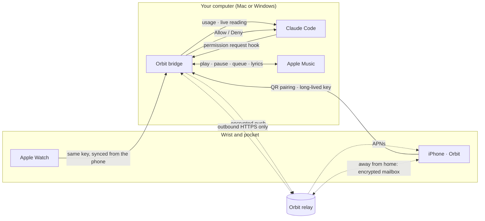

<p align="center">
  
</p>

<h1 align="center">Orbit</h1>

<p align="center">
  Your Claude Code quota, permission requests and Apple Music — on your iPhone and Apple Watch.<br>
  The computer keeps doing the work. Orbit keeps it within reach.
</p>

<p align="center">
  
  
  
  
  
  
</p>

<p align="center">
  <a href="https://github.com/zack-lz/Orbit/releases/latest">Download</a> ·
  <a href="#quick-start">Quick start</a> ·
  <a href="#features">Features</a> ·
  <a href="#security-and-privacy">Security</a> ·
  <a href="#troubleshooting">Troubleshooting</a> ·
  <a href="#中文说明">中文说明</a>
</p>

---

**Orbit** is a small companion system made of two parts:

1. the **Orbit app** for iPhone and Apple Watch, and
2. the **Orbit bridge** — a lightweight program you run on your own **Mac or Windows PC** (this repository).

The bridge reads your Claude Code usage, forwards Claude Code permission requests to your wrist, and controls Apple Music on the computer. The phone and watch talk to it directly over your home Wi-Fi. There is no Orbit cloud, no account on our side and nothing is uploaded.

> Orbit is an independent community project. It is not affiliated with, or endorsed by, Apple or Anthropic. "Claude", "Apple Music", "iPhone" and "Apple Watch" belong to their respective owners.

## How it works



* **Usage** — the bridge asks your own Claude Code installation for your 5-hour and 7-day limits, and can take a *live* reading with one tiny real request.
* **Approvals** — a Claude Code `PermissionRequest` hook pauses the request, the bridge shows it on your watch, and your tap becomes Claude's answer. If nobody answers in time, the normal prompt appears on the computer as usual.
* **Music** — the computer plays the music; Orbit only sends commands and shows what is playing.
* **Away from home** — on the home Wi-Fi the phone talks to the bridge directly. Anywhere else it uses an **end-to-end encrypted mailbox** on the Orbit relay (a small Cloudflare Worker): the bridge uploads fresh state and picks up your Allow / Deny answers with outbound HTTPS only — no port forwarding, no VPN. The relay only ever stores ciphertext.

## Features

| Area | What you get |
|---|---|
| **Quota** | Remaining 5-hour and 7-day Claude limits, reset countdowns, colour-coded ring, burn-rate forecast ("about 1 h 20 min until the window is full") |
| **Live refresh** | One tap on the reset countdown takes a live reading and replaces the number on screen — no waiting for cached data |
| **Today** | Replies, sessions, output / input / cache tokens, hourly activity bars and your most-used models, computed on your computer from local Claude Code transcripts |
| **Approvals** | Allow or Deny Claude Code permission requests from the Apple Watch or the lock screen; a history of recent decisions is kept |
| **Music remote** | Play / pause, previous / next, seek, volume, mute, cover art, Up Next, lyrics — with the same interface on Mac and Windows |
| **Apple Watch** | Quota and approvals on the wrist, plus a compact music remote. The watch is unlocked by your iPhone sign-in — no Face ID every time you glance at it |
| **Accounts** | Sign in with Apple. Every user starts with a blank Orbit and connects **their own** computer — nothing is shared between users |
| **Notifications** | Background push — **works for every user, even with the app closed**. Time-sensitive, with **Allow / Deny** buttons (Allow needs an unlocked iPhone). The text is end-to-end encrypted |
| **Away from home** | Quota, live refresh and approvals keep working off your Wi-Fi (cellular, office, travel) through the encrypted relay mailbox |
| **Languages** | English, 简体中文 and Français — follows the system or choose in Settings; the Apple Watch follows the iPhone |
| **Pairing** | Scan a QR code once. The connection is stored on the device and survives restarts |
| **Computers** | macOS and Windows, one bridge package each |

## Download

Pick the package for the computer that runs Claude Code and Apple Music:

| Computer | Package | What it contains |
|---|---|---|
| **Mac** | [Orbit-Bridge-mac.zip](https://github.com/zack-lz/Orbit/releases/latest/download/Orbit-Bridge-mac.zip) | Claude bridge + Music.app remote, installer script |
| **Windows** | [Orbit-Bridge-windows.zip](https://github.com/zack-lz/Orbit/releases/latest/download/Orbit-Bridge-windows.zip) | Claude bridge + Apple Music for Windows remote, one-click launcher |

All releases: **[github.com/zack-lz/Orbit/releases](https://github.com/zack-lz/Orbit/releases)**. The source of both packages is in [`mac/`](mac) and [`windows/`](windows).

### Requirements

| | Mac | Windows |
|---|---|---|
| OS | A recent macOS | Windows 10 / 11 |
| Python | Python 3 (`xcode-select --install`) | **64-bit Python 3.11** (the launcher helps you install it) |
| Packages | installed for you (`qrcode`, `cryptography`) | installed for you (see `requirements.txt`) |
| Music | Built-in **Music** app | **Apple Music for Windows** (Microsoft Store) |
| Claude quota & approvals | Claude Code installed and signed in | Claude Code installed and signed in |
| Network | iPhone and computer on the same Wi-Fi | iPhone and computer on the same Wi-Fi |

You do **not** need Claude Code to use only the Music remote, and you do not need Apple Music to use only the Claude features.

### The iPhone / Apple Watch app

The Orbit app itself is not part of this repository and is not on the App Store yet. It is installed on a device by its maintainer; this repository contains everything that runs on your computer. The in-app setup pages link to the packages above.

## Quick start

### 1 · Install the bridge

<details open>
<summary><b>Mac</b></summary>

1. Download and unzip **Orbit-Bridge-mac.zip**.
2. Open **Terminal**, go into the folder and run the installer:

   ```bash
   cd ~/Downloads/Orbit-Bridge
   ./install.sh
   ```

3. A browser page with **two QR codes** opens: one for **Claude**, one for **Music**.
4. The first time Orbit controls Music, macOS asks whether Python may control "Music". Click **OK**. (If you missed it: *System Settings → Privacy & Security → Automation*.)

The installer creates a private Python environment, a random access key, a background service that starts at login, and connects Claude Code (see [what it changes](#what-the-installer-changes)). Remove everything with `./install.sh --uninstall`.
</details>

<details open>
<summary><b>Windows</b></summary>

1. Download and unzip **Orbit-Bridge-windows.zip** into a **permanent** folder (for example `C:\Orbit`). Do not run it from inside the zip.
2. Double-click **`ENABLE_AUTO_START.bat`** — it prepares the environment, starts Orbit and makes it start silently after you sign in to Windows. For manual start-up only, double-click **`START.bat`** instead.
3. If Windows Firewall asks, allow Python on **Private networks**. Keep the firewall enabled.
4. Open **Apple Music** and play a song. A browser page with **two QR codes** opens: one for **Music**, one for **Claude**.

No Python 3.11? See [Installing Python 3.11 on Windows](#installing-python-311-on-windows).
</details>

### 2 · Pair the app

1. Put the iPhone and the computer on the same Wi-Fi.
2. Open **Orbit** and sign in with Apple.
3. **Music tab → Scan to add**: scan the QR code labelled **Music** (called *音乐控制 Music* on Windows).
4. **Claude tab → Scan to connect**: scan the QR code labelled **Claude**.
5. If the page shows several sets of codes, use the set that matches your home Wi-Fi address. Pairing is stored; you only do this once per computer.
6. The Apple Watch receives the connection from the iPhone automatically.

> The QR codes contain your private access key. Treat them like a password and never post screenshots.

### 3 · Use it

* **Claude tab** — ring = remaining 5-hour quota. Tap the circular-arrow row under it to take a live reading. Pull down to refresh.
* **Approvals** — when Claude Code asks for permission, a notification with **Allow** and **Deny** appears on your iPhone and Apple Watch. The app's Claude tab also lists pending requests and a history.
* **Music tab** — the full remote. Menu (⋯) lets you add another computer, switch computers, refresh or delete one.

## What the installer changes

Both packages connect Claude Code to Orbit by editing `~/.claude/settings.json` (a backup is made first):

| Setting | Purpose |
|---|---|
| `hooks.PermissionRequest` | Sends permission requests to the bridge so you can answer from the watch. If the bridge is down or nobody answers, nothing changes — you get the normal prompt. |
| `statusLine` | Gives the bridge live usage numbers while you use the terminal UI. Only set if you do not already have a status line. |

Mac: files live in `~/.claude-watch/`, the service is a user LaunchAgent (`com.orbit.bridge`).  
Windows: files live in the folder you unzipped, plus a Startup shortcut `Orbit Bridge.lnk` if you enabled auto-start.

## About quota accuracy

Claude's usage endpoint is cached on Anthropic's side and can be several minutes behind. Orbit therefore combines three sources:

1. **Live reading** — one minimal request (Haiku, a single turn, roughly US$0.001) made through *your own* Claude Code. The reply carries the real, current 5-hour and 7-day utilisation. Taken when you tap refresh, and about every 5 minutes while the app is open.
2. **Usage endpoint** — polled every 15 seconds, used between live readings.
3. **Status line** — used when your terminal Claude Code sends it.

Inside one limit window utilisation never goes down, so Orbit keeps the higher value; a new window replaces the old one. A live reading always wins.

## Music details

| | Mac (Music.app) | Windows (Apple Music) |
|---|---|---|
| Playback, seek, volume | ✅ | ✅ (volume = default output device of the PC) |
| Cover art, now playing | ✅ | ✅ |
| Up Next | next 30 tracks of the current playlist | loaded queue |
| Lyrics | plain text (the Music app does not expose timing) | timed lines, word-by-word when real timing exists |
| Mute | volume to 0 / restore | system mute |

The Music remote is the interface of the earlier [Apple Music Remote](https://github.com/zack-lz/Apple-Music-Remote) project, now bundled with Orbit.

## Installing Python 3.11 on Windows

1. Double-click `ENABLE_AUTO_START.bat` anyway — if Python 3.11 is missing, the launcher opens the official download page.
2. Either download the **Windows installer (64-bit)** for Python 3.11 and run it, or choose **Python install manager**, install it, then open a **new** PowerShell window and run:

   ```powershell
   py install 3.11
   ```

3. Close the old setup window and double-click `ENABLE_AUTO_START.bat` again. The script now creates the environment, installs dependencies, starts Orbit and enables start-up.

References: [Python 3.11 download](https://www.python.org/downloads/release/python-3119/) · [Python install manager](https://docs.python.org/3/using/windows.html#installing-runtimes)

## Security and privacy

* **Trusted network only.** The bridge listens on your LAN over plain HTTP and only accepts requests from private addresses. **Never forward port 8765 (or 8766) to the internet.**
* **Long, random key.** Every installation generates its own key (≥ 128 bits). Requests without it are rejected; after 8 wrong attempts from one address, that address is blocked for 5 minutes.
* **The QR code is the key.** Anyone with the full pairing link can read your quota and answer approval requests. Keys do not expire and are stored in plain text on the computer; revoke by deleting the key file and re-pairing (see [SECURITY.md](docs/SECURITY.md)).
* **No readable cloud copy.** Orbit has no accounts and no database of your data. The only external traffic is the Claude Code calls *your* Claude Code already makes, and — for push and remote access — **encrypted** messages through the Orbit relay (see [above](#push-notifications-and-the-relay)). The relay can see *that* a bridge is active and when, not what it says.
* **Approvals are narrow.** The bridge only relays what Claude Code's hook gives it (tool name and a short summary). Decisions are single-use; **Allow** from the lock screen requires an unlocked iPhone.
* **App lock.** The iPhone app requires Sign in with Apple and Face ID / passcode, re-locks after 30 seconds in the background and hides its content in the app switcher. The Apple Watch follows the iPhone sign-in.
* **Separate users.** Signing out, or signing in with a different Apple account, wipes all saved connections on that device.

Read the full [security notes](docs/SECURITY.md) before using Orbit outside a trusted home network.

### Push notifications and the relay

Apple only lets an app's **owner** send push notifications. So that every user gets them, bridges hand each notification to the **Orbit relay**, a tiny [Cloudflare Worker](relay) that forwards it to Apple (APNs).

* **End-to-end encrypted.** The bridge encrypts what Claude wants to do (tool + a short summary) with an AES-256-GCM key derived from *your* pairing token. The relay and Apple only see ciphertext and a generic fallback line; a notification extension on your iPhone decrypts it. If encryption is ever unavailable, the push carries no text and no Allow button — you just open the app.
* **What the relay stores:** an Apple device token and a hash of a random secret per phone, plus (for remote access) your latest *encrypted* state. It cannot read it.
* **Rate-limited and single-purpose:** it only serves this app, 20 pushes per minute per phone.
* **Remote access** uses the same relay: the bridge keeps an encrypted mailbox updated, the phone reads it when it can't reach your computer directly.
* Prefer not to use it? Set `ORBIT_REMOTE=0` for the bridge to disable remote access, and don't register for push (the app then only notifies while it is open). You can also run your own relay — see [relay/README.md](relay/README.md) — and point the bridge at it with `ORBIT_RELAY_URL`.

## Troubleshooting

| Symptom | Try this |
|---|---|
| The phone can't connect | Same Wi-Fi? Mac: `curl http://localhost:8765/health` should print `{"ok": true}`. Windows: allow Python on **Private networks**; ports **8765** (music) and **8766** (Claude). |
| QR page shows no QR image | The `qrcode` package is missing — re-run the installer / launcher. |
| "Not a valid Orbit QR code" | You scanned the other code. Claude tab wants the **Claude** code, Music tab wants the **Music** code. |
| Quota is empty | Claude Code must be installed and signed in on that computer (`claude auth login`). The bridge looks for `claude` on PATH and in the usual install folders. |
| Quota seems behind | Tap the refresh row for a live reading. |
| Mac: "can't control Music" | *System Settings → Privacy & Security → Automation* → allow the Python entry to control **Music**. |
| Mac: Music flashes between "connected / reconnecting" | Update to the latest package; the bridge now keeps state in the background and pushes it over WebSocket. |
| Windows: nothing happens at start-up | Run `START.bat` and read the window; logs are in `.state\server.log` and `.state\runner.log`. |
| Nothing works away from home | The bridge must be running on your computer (and the computer awake). Check `ORBIT_REMOTE` isn't `0`, and that `cryptography` is installed (re-run the installer). The status pill should say **Remote**. |
| No notification with the app closed | Open Orbit once while connected so it registers with the relay; allow notifications in iOS Settings; keep the computer awake. Notifications reach the watch when the iPhone is locked (iOS rule). |
| Approvals don't reach the watch | iPhone and computer on the same Wi-Fi? Open the Claude tab once so the bridge knows the app is active. Check Claude Code settings still contain the Orbit hook. |

## Uninstall

* **Mac:** `./install.sh --uninstall` (removes the service, hooks and `~/.claude-watch`).
* **Windows:** run `STOP.bat`, then `REMOVE_AUTO_START.bat`, then delete the folder. To remove the Claude hook, delete the `permission_hook.py` entry from `~/.claude/settings.json` (a backup `settings.json.bak-orbit` was made).
* **Phone:** delete a computer from the Music menu, or sign out in the app to clear all connections.

## Repository layout

```text
mac/        Orbit bridge for macOS   (orbit_bridge.py, music_mac.py, install.sh, web/)
windows/    Orbit bridge for Windows (orbit_bridge.py + Apple Music remote, START.bat …)
relay/      Orbit push relay (Cloudflare Worker) — push + encrypted remote mailbox
docs/       ARCHITECTURE.md · SECURITY.md
assets/     Icon
```

| Document | Contents |
|---|---|
| [Architecture](docs/ARCHITECTURE.md) | Components, ports, data flow, the quota model, the relay and the encryption scheme |
| [Relay](relay/README.md) | Deploying your own push relay |
| [Security](docs/SECURITY.md) | Threat model, pairing, revocation, what to avoid |
| [Mac guide](mac/README.md) | Detailed Mac setup |
| [Windows guide](windows/README.md) | Detailed Windows setup |

## Acknowledgements

The Windows music engine and the web remote are derived from [Apple Music Remote](https://github.com/zack-lz/Apple-Music-Remote). QR decoding uses [jsQR](https://github.com/cozmo/jsQR) (Apache-2.0, license included). QR generation uses [`qrcode`](https://pypi.org/project/qrcode/). Optional online lyric matching on Windows uses [LRCLIB](https://lrclib.net/) and is **off by default**.

---

## License

Copyright 2026 Zixian Lin. This repository (the Orbit bridge for Mac and Windows, and the push relay) is licensed under the [PolyForm Noncommercial License 1.0.0](LICENSE): you may read, use, and modify it for personal and other noncommercial purposes, but you may not use it commercially or sell it without permission. The Orbit iPhone / Apple Watch app itself is not part of this repository. Third-party files keep their own licenses (see `assets/jsQR-LICENSE.txt`).

## 中文说明

**Orbit 把你电脑上的 Claude Code 额度、授权请求和 Apple Music 带到 iPhone 和 Apple Watch 上。** 电脑照常工作，Orbit 让你随手可及。

它由两部分组成：**Orbit App**（iPhone + Apple Watch），以及运行在你自己的 **Mac 或 Windows 电脑**上的 **Orbit bridge**（本仓库）。手机和手表在家庭 Wi-Fi 内直接连接 bridge，没有 Orbit 云服务，不上传任何数据。

> 这是独立的社区项目，与 Apple、Anthropic 没有隶属或官方背书关系。

### 功能

| 模块 | 说明 |
|---|---|
| **额度** | 5 小时 / 7 天剩余额度、重置倒计时、彩色圆环、用量预测（“按当前速度约 1 时 20 分后用完”） |
| **实时刷新** | 点额度环下面的重置倒计时即可读取**实时**额度并替换显示，不用等缓存 |
| **今日用量** | 回复数、会话数、输出/输入/缓存 token、24 小时分布、常用模型（在你电脑上根据本地记录计算） |
| **授权** | 在 Apple Watch 或锁屏上同意/拒绝 Claude Code 的授权请求，并保留最近的授权记录 |
| **音乐遥控** | 播放/暂停、切歌、拖进度、音量、静音、封面、待播放、歌词；Mac 和 Windows 界面一致 |
| **Apple Watch** | 手腕上看额度、处理授权，并有精简的音乐遥控。手表跟随 iPhone 登录，不用每次刷脸 |
| **账户** | 使用 Apple 登录。每个用户从空白开始，连接**自己的**电脑，互不共享 |
| **通知** | 后台推送，**所有用户都能用，App 关闭也能收到**。紧急通知带“同意/拒绝”按钮（“同意”需要先解锁 iPhone），内容端到端加密 |
| **外出访问** | 不在家里 Wi-Fi 时（蜂窝网络、公司、旅行），额度、实时刷新和授权仍可用，走加密的中转信箱 |
| **语言** | English、简体中文、Français，默认跟随系统，也可在设置里选；Apple Watch 跟随 iPhone |
| **配对** | 扫一次二维码，长期保存，重启后无需重扫 |

### 下载

| 电脑 | 下载 | 内容 |
|---|---|---|
| **Mac** | [Orbit-Bridge-mac.zip](https://github.com/zack-lz/Orbit/releases/latest/download/Orbit-Bridge-mac.zip) | Claude bridge + “音乐”遥控 + 安装脚本 |
| **Windows** | [Orbit-Bridge-windows.zip](https://github.com/zack-lz/Orbit/releases/latest/download/Orbit-Bridge-windows.zip) | Claude bridge + Apple Music for Windows 遥控 + 一键启动 |

所有版本见 [Releases](https://github.com/zack-lz/Orbit/releases)。两个版本的源码分别在 [`mac/`](mac) 和 [`windows/`](windows)。

**环境要求**

| | Mac | Windows |
|---|---|---|
| 系统 | 较新的 macOS | Windows 10 / 11 |
| Python | Python 3（`xcode-select --install`） | **64 位 Python 3.11**（启动器会引导安装） |
| 音乐 | 自带“音乐”App | **Apple Music for Windows**（Microsoft Store） |
| Claude 额度与授权 | 已安装并登录 Claude Code | 已安装并登录 Claude Code |
| 网络 | iPhone 与电脑在同一个 Wi-Fi | iPhone 与电脑在同一个 Wi-Fi |

只用音乐遥控可以不装 Claude Code；只看额度也不需要 Apple Music。Orbit App 本身目前不在 App Store，由维护者安装到设备；App 内的设置页会链接到上面的下载包。

### 快速开始

**第 1 步：在电脑上安装 bridge**

**Mac**

1. 下载并解压 **Orbit-Bridge-mac.zip**。
2. 打开“终端”，进入文件夹并运行安装脚本：

   ```bash
   cd ~/Downloads/Orbit-Bridge
   ./install.sh
   ```

3. 浏览器会自动打开一个带**两个二维码**的页面：一个给 **Claude**，一个给 **音乐**。
4. 第一次控制音乐时，macOS 会询问是否允许 Python 控制“音乐”，点 **好**。漏掉了就到 *系统设置 → 隐私与安全性 → 自动化* 里打开。

卸载：`./install.sh --uninstall`。

**Windows**

1. 下载 **Orbit-Bridge-windows.zip**，解压到一个**固定文件夹**（如 `C:\Orbit`），不要在压缩包里直接运行。
2. 双击 **`ENABLE_AUTO_START.bat`**：它会准备环境、启动 Orbit，并设置登录 Windows 后自动静默启动。只想手动运行就双击 **`START.bat`**。
3. 防火墙提示时，允许 Python 访问**专用网络**，保持防火墙开启。
4. 打开 Apple Music 并播放一首歌。浏览器会出现带**两个二维码**的页面：**音乐**和 **Claude**。

没有 Python 3.11？见下面的“Windows 安装 Python 3.11”。

**第 2 步：在 App 里配对**

1. iPhone 与电脑连同一个 Wi-Fi，打开 Orbit 并用 Apple 登录。
2. **音乐**页 → “扫码添加”，扫标有 **音乐** 的二维码。
3. **Claude** 页 → “扫码连接”，扫标有 **Claude** 的二维码。
4. 页面里有多组二维码时，选与你家 Wi-Fi 对应的那一组。配对后长期保存，手表会自动从 iPhone 获得连接。

二维码里含有访问密钥，请当作密码，不要把截图发给别人。

**第 3 步：使用**

* **Claude 页**：圆环是 5 小时剩余额度，点下面的循环箭头一行读取实时额度，下拉也可刷新。
* **授权**：Claude Code 需要授权时，iPhone 和 Apple Watch 会收到带“同意/拒绝”按钮的通知。
* **音乐页**：完整遥控器；右上角菜单可以添加、切换、刷新或删除电脑。

### 安装脚本会改什么

两个包都会修改 `~/.claude/settings.json`（先备份）：

| 设置 | 作用 |
|---|---|
| `hooks.PermissionRequest` | 把授权请求交给 bridge，让你在手表上回答。bridge 没运行或没人回答时，一切照旧，仍是电脑上的原提示。 |
| `statusLine` | 在终端界面使用 Claude Code 时提供实时用量。只在你还没有状态栏时才设置。 |

### 关于额度的准确性

Claude 的用量接口在 Anthropic 一侧有缓存，可能晚几分钟。Orbit 综合三个来源：

1. **实时读取**：通过**你自己的** Claude Code 发一次极小的请求（Haiku、单轮，约 0.001 美元），返回里带有真实、当前的 5 小时/7 天用量。点刷新时读取，App 打开时约每 5 分钟读一次。
2. **用量接口**：每 15 秒轮询，在两次实时读取之间使用。
3. **状态栏**：终端里的 Claude Code 推送时使用。

同一个额度窗口内用量只增不减，所以 Orbit 保留较高的值；进入新窗口则用新值。实时读取始终优先。

### 音乐功能差异

| | Mac（“音乐”App） | Windows（Apple Music） |
|---|---|---|
| 播放、进度、音量 | ✅ | ✅（音量为电脑默认输出设备） |
| 封面、正在播放 | ✅ | ✅ |
| 待播放 | 当前播放列表后 30 首 | 已加载的队列 |
| 歌词 | 纯文本（“音乐”App 不提供时间轴） | 逐行同步；有真实词时间时逐字高亮 |
| 静音 | 音量调为 0 / 恢复 | 系统静音 |

### Windows 安装 Python 3.11

1. 先双击 `ENABLE_AUTO_START.bat`，如果找不到 Python 3.11，启动器会打开官方下载页面。
2. 下载 Python 3.11 的 **Windows installer (64-bit)** 并安装；或者选择 **Python install manager**，安装后打开一个**新的** PowerShell 窗口执行：

   ```powershell
   py install 3.11
   ```

3. 关闭之前的启动窗口，再次双击 `ENABLE_AUTO_START.bat`，脚本会继续创建环境、安装依赖、启动并设置自启。

### 安全与隐私

* **只用于可信网络。** bridge 在局域网内以明文 HTTP 监听，并且只接受来自私有地址的请求。**不要把 8765/8766 端口开放到公网。**
* **长随机密钥。** 每次安装各自生成密钥（不少于 128 位）；没有密钥的请求会被拒绝；同一地址连续 8 次错误后，5 分钟内被拒绝。
* **二维码就是密钥。** 拿到完整配对链接的人可以读取你的额度、回答授权请求。密钥不会过期，以明文保存在电脑上；撤销方法是删除密钥文件后重新配对（见 [SECURITY.md](docs/SECURITY.md)）。
* **没有可读的云端副本。** Orbit 没有账户体系，也没有你的数据库。除了你自己的 Claude Code 本来就会发出的请求，推送和外出访问只经过 Orbit 中转服务，而且是**加密**的；中转服务能看到某个 bridge 是否在线，看不到内容。
* **授权范围很窄。** bridge 只转发 Claude Code 钩子给它的内容（工具名与简短摘要）；每个决定只能用一次；锁屏上点“同意”需要先解锁 iPhone。
* **App 锁。** iPhone App 需要 Apple 登录和 Face ID/密码，后台超过 30 秒自动锁定，切换 App 时内容会被遮住；Apple Watch 跟随 iPhone 的登录状态。
* **用户隔离。** 退出登录，或换另一个 Apple 账号登录，会清除这台设备上保存的全部连接。

**推送通知与中转服务：** Apple 只允许 App 的**所有者**发送推送。为了让每个用户都能收到，bridge 会把通知交给 **Orbit 中转服务**（一个很小的 [Cloudflare Worker](relay)），由它转发给 Apple（APNs）。

* **端到端加密。** bridge 用从**你的**配对密钥派生出的 AES-256-GCM 密钥，加密 Claude 要做的事（工具名和简短摘要）。中转服务和 Apple 只看到密文和一句通用提示，由 iPhone 上的通知扩展解密。如果无法加密，推送不带文字也没有“同意”按钮，你只需打开 App。
* **中转服务保存的内容：** 每部手机一个 Apple 设备令牌和一个随机密钥的哈希；用于外出访问时，还有你最近一次**加密后**的状态。它无法读取。
* **限流且只服务本 App：** 每部手机每分钟最多 20 条推送。
* **外出访问**用同一个中转：bridge 持续更新加密信箱，手机连不上电脑时读取它。
* 不想使用？给 bridge 设置 `ORBIT_REMOTE=0` 即可关闭外出访问，并且不注册推送（App 就只在打开时提醒）。你也可以自己部署中转，见 [relay/README.md](relay/README.md)，再用 `ORBIT_RELAY_URL` 指向它。

### 常见问题

| 现象 | 处理 |
|---|---|
| 手机连不上 | 是否同一个 Wi-Fi？Mac 上 `curl http://localhost:8765/health` 应输出 `{"ok": true}`；Windows 需允许 Python 访问**专用网络**，端口 **8765**（音乐）和 **8766**（Claude）。 |
| 二维码页没有图片 | 缺少 `qrcode` 包，重新运行安装脚本或启动器。 |
| 提示“不是有效的 Orbit 二维码” | 扫错了：Claude 页要扫 **Claude** 码，音乐页要扫 **音乐** 码。 |
| 额度是空的 | 电脑上要安装并登录 Claude Code（`claude auth login`）；bridge 会在 PATH 和常见安装位置查找 `claude`。 |
| 额度显示偏旧 | 点刷新那一行读取实时额度。 |
| Mac：无法控制“音乐” | *系统设置 → 隐私与安全性 → 自动化*，允许 Python 控制“音乐”。 |
| Windows：开机没反应 | 运行 `START.bat` 看窗口提示；日志在 `.state\server.log` 与 `.state\runner.log`。 |
| 外出时不能用 | 电脑上的 bridge 必须在运行（电脑不要休眠）；确认没有设置 `ORBIT_REMOTE=0`，且已安装 `cryptography`（重新运行安装脚本）。状态标签应显示“远程”。 |
| App 关闭后收不到通知 | 连接状态下先打开一次 Orbit 让它向中转服务注册；在 iOS 设置里允许通知；电脑保持唤醒。iPhone 锁屏后通知才会同步到手表（iOS 规则）。 |
| 授权收不到 | iPhone 与电脑是否同一 Wi-Fi？先打开一次 Claude 页，让 bridge 知道 App 在用；确认 Claude Code 设置里仍有 Orbit 钩子。 |

### 卸载

* **Mac：** `./install.sh --uninstall`（移除服务、钩子和 `~/.claude-watch`）。
* **Windows：** 运行 `STOP.bat` → `REMOVE_AUTO_START.bat`，然后删除文件夹。要移除 Claude 钩子，删掉 `~/.claude/settings.json` 里的 `permission_hook.py` 一项（已有备份 `settings.json.bak-orbit`）。
* **手机：** 在音乐页菜单里删除电脑，或在 App 里退出登录以清除所有连接。

### 致谢

Windows 音乐引擎和网页遥控器源自 [Apple Music Remote](https://github.com/zack-lz/Apple-Music-Remote)。二维码识别使用 [jsQR](https://github.com/cozmo/jsQR)（Apache-2.0，附许可证）；二维码生成使用 [`qrcode`](https://pypi.org/project/qrcode/)。Windows 上可选的在线歌词匹配使用 [LRCLIB](https://lrclib.net/)，默认关闭。

### 许可证

版权所有 2026 Zixian Lin。本仓库（Mac / Windows 版 bridge 与推送中转服务）采用 [PolyForm Noncommercial License 1.0.0](LICENSE) 许可：你可以出于个人及其他非商业目的阅读、使用和修改，但未经许可不得商用或出售。Orbit 的 iPhone / Apple Watch App 本身不在本仓库内。第三方文件保留其各自的许可证（见 `assets/jsQR-LICENSE.txt`）。

详细说明见 [架构](docs/ARCHITECTURE.md)、[安全](docs/SECURITY.md)、[Mac 指南](mac/README.md)、[Windows 指南](windows/README.md)。
